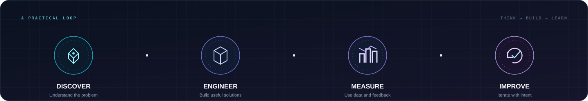
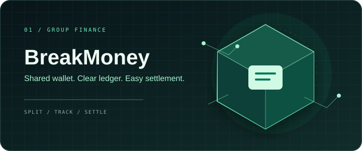
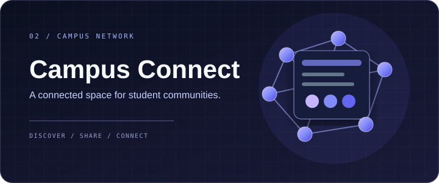
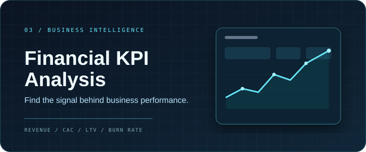

 

<h3>Namaste 🙏, I'm Ayush Maurya</h3>

<strong>Full-Stack Developer &nbsp;·&nbsp; Data Analyst &nbsp;·&nbsp; Product & Business Enthusiast</strong>

 

&nbsp;

&nbsp;

  

<a href="#about">ABOUT</a>
&nbsp;·&nbsp;
<a href="#experience">EXPERIENCE</a>
&nbsp;·&nbsp;
<a href="#selected-work">SELECTED WORK</a>
&nbsp;·&nbsp;
<a href="#toolkit">TOOLKIT</a>
&nbsp;·&nbsp;
<a href="#github-activity">GITHUB ACTIVITY</a>
&nbsp;·&nbsp;
<a href="#connect">CONNECT</a>

---

## 01 &nbsp; / &nbsp; THE PERSON BEHIND THE CODE

<table>
<tr>
<td width="66%" valign="top">

I'm a **B.Tech Computer Science student** passionate about **Software Development, Data Analytics, Product Strategy, and Business Growth**.

I enjoy building end-to-end applications, extracting insights from data, understanding user needs, and creating technology-driven solutions that solve real-world problems.

My interests connect three disciplines:

- **Engineering** — Full-Stack Development (MERN Stack)
- **Intelligence** — Data Analytics & Business Intelligence
- **Product** — AI-Powered Applications, Product Management & Growth Strategy

I also enjoy Business Development, Market Analysis, and continuous learning.

</td>
<td width="34%" valign="top" align="center">

  

<strong>AYUSH MAURYA</strong>

DEVELOPER · ANALYST · BUILDER

  

</td>
</tr>
</table>

### THE PROFESSIONAL TOOLKIT

| ENGINEERING | DATA & INSIGHTS | PRODUCT & STRATEGY |
|:--|:--|:--|
| React, Node.js, Express.js | Power BI, SQL, Looker Studio | Product Thinking |
| MongoDB, PostgreSQL | Python, EDA & Analytics | Business Strategy |
| AI Integration & Automation | KPI Monitoring & Dashboards | Growth & Market Analysis |

---

## 02 &nbsp; / &nbsp; EXPERIENCE

<table>
<tr>
<td width="7%" valign="top">01</td>
<td width="93%" valign="top">

### Full-Stack Development Intern
**Dataman Computer Systems** &nbsp; / &nbsp; SOFTWARE · AI

- Developed features for an AI-powered Study Assistant platform.
- Built React + TypeScript interfaces.
- Worked with FastAPI, MongoDB & PostgreSQL.
- Contributed to Retrieval-Augmented Generation (RAG) workflows.

</td>
</tr>
<tr><td colspan="2">
</td></tr>
<tr>
<td width="7%" valign="top">02</td>
<td width="93%" valign="top">

### Data Analyst Intern
**Elevate Labs** &nbsp; / &nbsp; ANALYTICS · BUSINESS INTELLIGENCE

- Analyzed sales performance and KPIs.
- Built interactive Power BI dashboards.
- Conducted Data Cleaning & Exploratory Data Analysis.
- Generated actionable business insights.

</td>
</tr>
<tr><td colspan="2">
</td></tr>
<tr>
<td width="7%" valign="top">03</td>
<td width="93%" valign="top">

### Data Visualization Associate
**Excelerate** &nbsp; / &nbsp; DATA VISUALIZATION · REPORTING

- Built business dashboards using Looker Studio.
- Created analytical reports using PostgreSQL.
- Delivered stakeholder-focused insights and reporting.

</td>
</tr>
</table>

---

## 03 &nbsp; / &nbsp; SELECTED WORK

THREE DIFFERENT PROBLEMS. ONE CONSISTENT APPROACH: BUILD FOR USEFULNESS.

<table>
<tr>
<td width="50%" valign="top">

### BreakMoney
**Shared Expense Manager & Group Wallet**

A shared finance experience designed to make group expenses, wallet activity, and settlements easier to manage.

- Real-time shared wallet management
- Automated expense splitting
- Smart settlement calculation
- UPI-based payment workflows

TECH STACK

<code>React</code> <code>Node.js</code> <code>Express</code> <code>MongoDB</code>

</td>
<td width="50%" valign="top">

### Campus Connect
**College Community Platform**

A student-focused platform for building college communities and sharing campus resources.

- JWT Authentication & OTP Verification
- Community Management System
- Student Dashboards
- REST API Architecture

TECH STACK

<code>React</code> <code>Tailwind CSS</code> <code>Express</code> <code>MongoDB</code>

</td>
</tr>
<tr><td colspan="2">
</td></tr>
<tr>
<td colspan="2" valign="top">

### Financial KPI Analysis
**Business Intelligence & Analytics**

An analytical project focused on tracking business health and turning performance data into useful insights.

- Revenue Growth Analysis
- CAC & LTV Tracking
- Burn Rate Monitoring
- Interactive Business Dashboards

TECH STACK

<code>Python</code> <code>Pandas</code> <code>Excel</code> <code>Tableau</code>

</td>
</tr>
</table>

---

## 04 &nbsp; / &nbsp; CAREER INTERESTS

| 💻 Full-Stack Development | 📊 Data Analytics | 🚀 Product Management |
|:---:|:---:|:---:|
| 📈 Business Development | 🤖 AI Products | 📉 Business Intelligence |

---

## 05 &nbsp; / &nbsp; TECHNOLOGY & TOOLS

EVERY TOOL IS SHOWN WITH ITS BRAND MARK AND NAME

### DEVELOPMENT

### DATABASES & BACKEND

### DATA & ANALYTICS

### TOOLS & WORKFLOW

---

## 06 &nbsp; / &nbsp; WHAT I'M EXPLORING

&nbsp;

&nbsp;

 

&nbsp;

- Product Management
- Machine Learning
- Cloud Computing
- AI Agents & Automation
- Business Growth Strategy

---

## 07 &nbsp; / &nbsp; MILESTONES & RECOGNITION

HACKATHONS · INDUSTRY EXPOSURE · TECHNICAL TRAINING · PROFESSIONAL CERTIFICATES

### 01 / Hackathons & innovation

<table>
<tr>
<td width="50%" valign="top">

**01.1 · HACKATHON PARTICIPATION**

#### 🚀 Geeks2Code Hackathon

Participated in the **Geeks2Code Hackathon**, organized by the **GFG Campus Body, MIET Meerut**.

MIET MEERUT · PARTICIPATION CERTIFICATE

</td>
<td width="50%" valign="top">

**01.2 · STARTUP PITCH**

#### 💡 National Startup Pitch Competition 2026

Participated as part of **Team The Night Agents**, representing **Sanskriti University**, in the competition organized by **YAI Infraventure**.

TEAM · THE NIGHT AGENTS

</td>
</tr>
<tr><td colspan="2">
</td></tr>
<tr>
<td width="50%" valign="top">

**01.3 · AI INNOVATION**

#### 🤖 AI Startup Buildathon 2026

Participated in the **Beauty Salon Marketplace Challenge**, part of the **SuperXGen AI Builder Series**, organized by **SuperXGen** through **Unstop**.

BEAUTY SALON MARKETPLACE CHALLENGE

</td>
<td width="50%" valign="top">

**01.4 · NATIONAL-LEVEL HACKATHON**

#### 🇮🇳 Build With Bharat 2.0

Participated in the **24-hour national-level hackathon** on **13–14 September** at the **National Institute of Technology Delhi**, organized by **CodeVerse**.

IN-PERSON HACKATHON · NIT DELHI

</td>
</tr>
</table>

### 02 / Industry exposure & workshops

<table>
<tr>
<td width="50%" valign="top">

#### 💼 Data Science Internship

**Navodita Infotech**

Received a Data Science internship offer from **Navodita Infotech** and shared a follow-up post highlighting work and learning from the internship.

INTERNSHIP EXPERIENCE · DATA SCIENCE

</td>
<td width="50%" valign="top">

#### ☁️ AZ-900: Microsoft Azure Cloud Computing

Participated in the AZ-900 workshop on **18 July 2026**, organized by the **School of Engineering & Information Technology, Sanskriti University, Mathura, U.P.**

WORKSHOP · 18 JULY 2026

</td>
</tr>
</table>

### 03 / Professional certificates & technical learning

<table>
<tr>
<td width="50%" valign="top">

**03.1 · DATA SCIENCE**

#### 🐍 Data Science with Python Bootcamp

Successfully completed the **3-day bootcamp by LetsUpgrade**, held from **5–7 June 2025**. Certificate issued **12 June 2025**.

Delivered in collaboration with **National Skill Development Corporation (NSDC)**, **ITM Edutech Training Pvt. Ltd.**, and **GDG MAD**.

LETSUPGRADE · 3-DAY BOOTCAMP

</td>
<td width="50%" valign="top">

**03.2 · DATABASES & SQL**

#### 🗄️ Introduction to Database Management and SQL

Completed the course offered by **Newton School** on **30 April 2025**.

NEWTON SCHOOL · CERTIFICATE OF ACHIEVEMENT

</td>
</tr>
<tr><td colspan="2">
</td></tr>
<tr>
<td width="50%" valign="top">

**03.3 · PYTHON**

#### 🐍 Free Python Course

Completed the **3-week Free Python Course — Updated [2025]**, offered by **GeeksforGeeks**.

GEEKSFORGEEKS · 3-WEEK COURSE

</td>
<td width="50%" valign="top">

**03.4 · ARTIFICIAL INTELLIGENCE**

#### ✳ Google AI Professional Certificate

Completed the **Google AI Professional Certificate** by **Google**, through **Coursera**, on **25 July 2026**.

The certificate covers seven courses, including AI fundamentals, brainstorming and planning, research, writing, content creation, data analysis, and app building.

GOOGLE · COURSERA · 7-COURSE CERTIFICATE

</td>
</tr>
<tr><td colspan="2">
</td></tr>
<tr>
<td colspan="2" valign="top">

**03.5 · FULL-STACK WEB DEVELOPMENT**

#### 🎓 Full-Stack Web Development Specialization

Completed the **Full-Stack Web Development Specialization** offered by the **University of London** through **Coursera**.

The course certificates shared include:

- **HTML: How to Build a Website** — 28 July 2026
- **CSS: Web Page Layout – Usability and Accessibility** — 28 July 2026
- **Data-driven Websites: JSON, APIs and Templates** — 28 July 2026

UNIVERSITY OF LONDON · COURSERA · WEB DEVELOPMENT

</td>
</tr>
</table>
---

## 08 &nbsp; / &nbsp; GITHUB ACTIVITY

LIVE PROFILE STATISTICS · LANGUAGE DISTRIBUTION · CONTRIBUTION ACTIVITY

  

  

---

## 09 &nbsp; / &nbsp; LET'S CONNECT

**Interested in technology, meaningful products, data, and ideas that create impact.**

 

&nbsp;

&nbsp;

  

