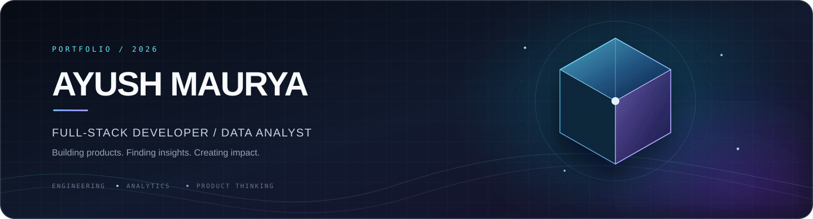
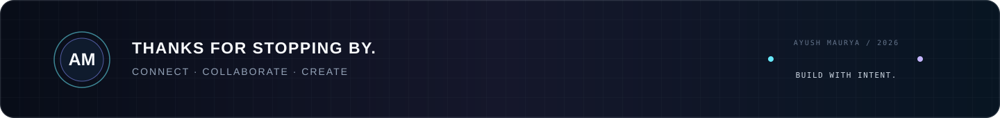

 

<h3>Namaste 🙏, I'm Ayush Maurya</h3>

<strong>Full-Stack Developer&nbsp; · &nbsp;Data Analyst&nbsp; · &nbsp;Product & Business Enthusiast</strong>

 

&nbsp;

&nbsp;

---

## 01 / About

<table>
<tr>
<td width="62%" valign="top">

I'm a **B.Tech Computer Science student** passionate about **Software Development, Data Analytics, Product Strategy, and Business Growth**.

I enjoy building end-to-end applications, extracting insights from data, understanding user needs, and creating technology-driven solutions that solve real-world problems.

My work sits across three connected areas:

- **Build** — Full-Stack Development (MERN Stack)
- **Understand** — Data Analytics & Business Intelligence
- **Improve** — AI-Powered Applications, Product Management & Growth Strategy

I also enjoy Business Development, Market Analysis, and continuous learning.

</td>
<td width="38%" valign="top">

### CURRENT FOCUS

<table>
<tr><td>⌘</td><td><strong>Engineering</strong> Web applications & APIs</td></tr>
<tr><td>◫</td><td><strong>Analytics</strong> Data, KPIs & dashboards</td></tr>
<tr><td>✳</td><td><strong>AI exploration</strong> Intelligent products & automation</td></tr>
<tr><td>↗</td><td><strong>Product</strong> Strategy, users & growth</td></tr>
</table>

</td>
</tr>
</table>

### PROFESSIONAL SUMMARY

Experienced in developing full-stack applications with modern web technologies while leveraging analytics tools to support business decision-making.

| ENGINEERING | DATA & INSIGHTS | PRODUCT & STRATEGY |
|:---|:---|:---|
| React, Node.js, Express.js | Power BI, SQL, Looker Studio | Product Thinking |
| MongoDB, PostgreSQL | Python, EDA & Analytics | Business Strategy |
| AI Integration & Automation | KPI Monitoring & Dashboards | Growth & Market Analysis |

---

## 02 / Experience

<table>
<tr>
<td width="5%" valign="top"><strong>01</strong></td>
<td width="95%" valign="top">

### Full-Stack Development Intern
**Dataman Computer Systems** &nbsp; DEVELOPMENT / AI

- Developed features for an AI-powered Study Assistant platform.
- Built React + TypeScript interfaces.
- Worked with FastAPI, MongoDB & PostgreSQL.
- Contributed to Retrieval-Augmented Generation (RAG) workflows.

</td>
</tr>
<tr>
<td colspan="2">
</td>
</tr>
<tr>
<td width="5%" valign="top"><strong>02</strong></td>
<td width="95%" valign="top">

### Data Analyst Intern
**Elevate Labs** &nbsp; ANALYTICS / BUSINESS INTELLIGENCE

- Analyzed sales performance and KPIs.
- Built interactive Power BI dashboards.
- Conducted Data Cleaning & Exploratory Data Analysis.
- Generated actionable business insights.

</td>
</tr>
<tr>
<td colspan="2">
</td>
</tr>
<tr>
<td width="5%" valign="top"><strong>03</strong></td>
<td width="95%" valign="top">

### Data Visualization Associate
**Excelerate** &nbsp; DATA VISUALIZATION / REPORTING

- Built business dashboards using Looker Studio.
- Created analytical reports using PostgreSQL.
- Delivered stakeholder-focused insights and reporting.

</td>
</tr>
</table>

---

## 03 / Selected Work

PRODUCTS, PLATFORMS & ANALYTICAL PROJECTS

<table>
<tr>
<td width="50%" valign="top">

### 01 — BreakMoney
**Shared Expense Manager & Group Wallet**

A shared finance experience designed to make group expenses, wallet activity, and settlements easier to manage.

- Real-time shared wallet management
- Automated expense splitting
- Smart settlement calculation
- UPI-based payment workflows

TECH STACK

<code>React</code> <code>Node.js</code> <code>Express</code> <code>MongoDB</code>

</td>
<td width="50%" valign="top">

### 02 — Campus Connect
**College Community Platform**

A student-focused platform for building college communities and sharing campus resources.

- JWT Authentication & OTP Verification
- Community Management System
- Student Dashboards
- REST API Architecture

TECH STACK

<code>React</code> <code>Tailwind CSS</code> <code>Express</code> <code>MongoDB</code>

</td>
</tr>
<tr>
<td colspan="2">
</td>
</tr>
<tr>
<td colspan="2" valign="top">

### 03 — Financial KPI Analysis
**Business Intelligence & Analytics**

An analytical project focused on tracking business health and turning performance data into useful insights.

- Revenue Growth Analysis
- CAC & LTV Tracking
- Burn Rate Monitoring
- Interactive Business Dashboards

TECH STACK

<code>Python</code> <code>Pandas</code> <code>Excel</code> <code>Tableau</code>

</td>
</tr>
</table>

---

## 04 / Career Interests

| 💻 Full-Stack Development | 📊 Data Analytics | 🚀 Product Management |
|:---:|:---:|:---:|
| 📈 Business Development | 🤖 AI Products | 📉 Business Intelligence |

---

## 05 / Toolkit

TECHNOLOGIES I HAVE WORKED WITH

### DEVELOPMENT

### DATABASES & BACKEND

### DATA & ANALYTICS

 

### TOOLS & WORKFLOW

---

## 06 / Currently Learning

&nbsp;

&nbsp;

 

&nbsp;

- Product Management
- Machine Learning
- Cloud Computing
- AI Agents & Automation
- Business Growth Strategy

---

## 07 / Achievements

<table>
<tr>
<td width="50%" valign="top">

- 🏆 Smart India Hackathon Participant
- 🏆 AI Startup Buildathon Participant
- 🏆 Government of India Power BI Program

</td>
<td width="50%" valign="top">

- 🏆 Google AI Professional Certificate
- 🏆 Full-Stack Web Development Certification

</td>
</tr>
</table>

---

## 08 / GitHub Activity

CONTRIBUTIONS · LANGUAGES · CONSISTENCY

  

  

---

## 09 / Connect

**Interested in technology, meaningful products, data, and ideas that create impact.**

 

&nbsp;

&nbsp;

  

BUILDING PRODUCTS&nbsp; · &nbsp;ANALYZING DATA&nbsp; · &nbsp;DRIVING GROWTH

  

